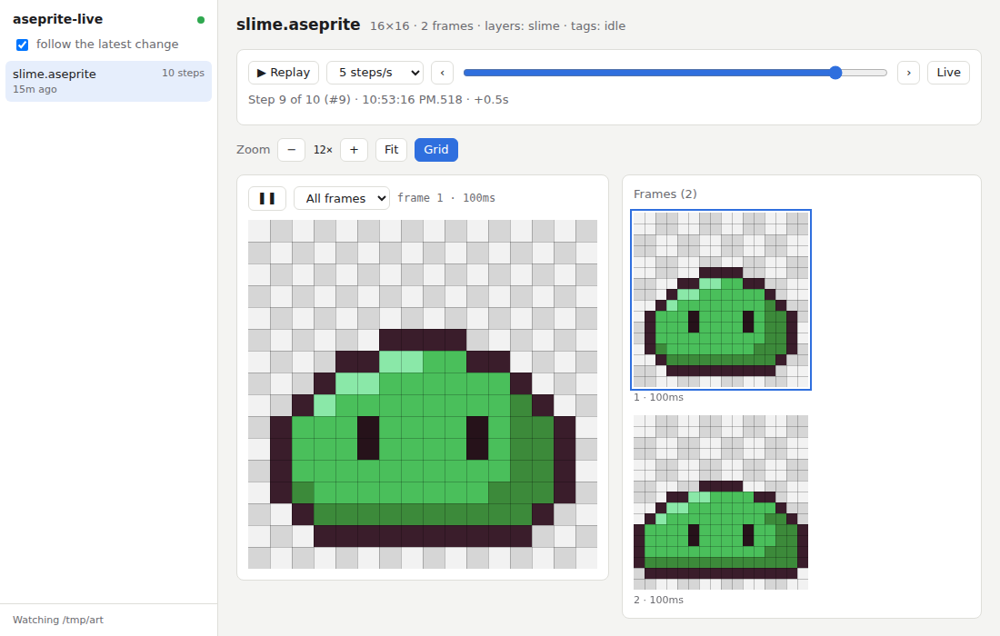

# aseprite-live

Watch an AI agent draw pixel art in Aseprite, live, in your browser.

Agents using the [Aseprite MCP server](https://github.com/diivi/aseprite-mcp) save the `.aseprite` file after every tool call, but the Aseprite app doesn't reload files changed on disk. `aseprite-live` watches a folder, renders each file whenever it's saved, and keeps every version so you can replay the whole drawing step by step.



- Live updates, no refresh needed
- All frames side by side, with a pixel grid and zoom
- Animated preview at the real frame durations, per tag
- A timeline of every save, with a slider and replay
- Optional MCP proxy that labels each step with the tool call that made it

Python 3.12+, standard library only. No dependencies, no build step.

## Install

You need [uv](https://docs.astral.sh/uv/) and Aseprite.

```sh
git clone https://github.com/N7z/aseprite-live
export ASEPRITE_PATH=/path/to/aseprite   # if it's not on your PATH
```

Optionally put the launcher on your `PATH`:

```sh
ln -s "$PWD/aseprite-live/aseprite-live" ~/.local/bin/aseprite-live
```

## Use

```sh
aseprite-live            # watch the current folder
aseprite-live ~/art      # or another one
```

Open the URL it prints (`http://localhost:7777/` by default). It only listens on `127.0.0.1`. On WSL2, open it in your Windows browser.

Try it without an agent: the demo draws a slime in 10 saves.

```sh
mkdir -p /tmp/art && cd /tmp/art && aseprite-live &
path/to/aseprite-live/examples/demo.sh /tmp/art/slime.aseprite
```

Keys: `←` `→` step, `Home` `End` first/latest, `R` replay, `Space` play/pause, `G` grid, `+` `-` zoom.

Options: `--port N`, `--aseprite PATH`, `--max-steps N` (default 200).

## MCP proxy mode

Run the MCP server through `aseprite-live` to see which tool call made each step. It forwards every message unchanged.

```sh
aseprite-live proxy [--watch DIR] [--port N] -- <command that starts the MCP server>
```

For example, in Claude Code's `.mcp.json`:

```json
{
  "mcpServers": {
    "aseprite": {
      "command": "/path/to/aseprite-live/aseprite-live",
      "args": ["proxy", "--watch", "/path/to/art", "--",
               "uv", "--directory", "/path/to/aseprite-mcp", "run", "-m", "aseprite_mcp"],
      "env": { "ASEPRITE_PATH": "/path/to/aseprite" }
    }
  }
}
```

The viewer URL goes to stderr, since stdout carries MCP. Folders of absolute sprite paths seen in tool calls are watched automatically.

## How it works

- Polls the folder every 150 ms, so it works anywhere, including `/mnt/c` on WSL.
- Debounces saves per file and never renders the same file twice at once.
- Renders all frames in one Aseprite CLI call (`--sheet` + `--data`) from a private copy of the file.
- Skips half-written files by checking the size in the `.aseprite` header. On an error, the page shows it and keeps the last good render.
- A save that looks exactly like the previous one doesn't add a step. History lives in memory, 200 steps per file.

## Tests

```sh
uv run python -m unittest -v
```

## License

[AGPL-3.0](LICENSE)
